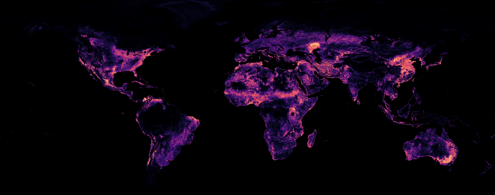

# Global Solar Siting from Geospatial Embeddings

Code, model and data access for **a global 10 m map of solar PV siting suitability**, learnt from where solar has
actually been built. A random forest + MLP ensemble reads each 10 m pixel's
[AlphaEarth Foundations](https://deepmind.google/discover/blog/alphaearth-foundations-helps-map-our-planet-in-unprecedented-detail/)
(AEF) embedding (64 numbers summarising a year of satellite observations) and predicts `P(solar)`: how much the land
resembles land that later became a solar farm, two years before construction.

> 📦 **Dataset — solar_suitability v1.0 (global, 10 m, AEF 2025): DOI coming soon** (CEDA archive; link added here at release)<br>
> 📄 **Paper:** Rehman, Paletta & Song, *Global Solar Siting from Geospatial Embeddings*, Tackling Climate Change with
> Machine Learning workshop, NeurIPS 2026 — link coming soon ([citation](#citation))



*Global suitability (AEF 2025); brighter = more suitable. Preview of the 10 m dataset.*

**What you can do with this repository**

| | | |
|---|---|---|
| **Map any region, any year** | country, bounding box or your own polygon; AEF 2017 onwards; runs on a laptop, no Earth Engine | [`scripts/predict.py`](#map-any-region-and-year) |
| **Use the released dataset** | download a country or area of the global map, as raw scores or within-country percentiles | [`scripts/get_dataset.py`](#use-the-released-dataset) |
| **Validate a map** | score solar sites built after the map's year against random land | [`scripts/validate.py`](#reproduce-the-paper) |
| **Reproduce the paper** | method benchmark (Table 1), forward validation, MCDA comparison, retraining | [`docs/reproduce.md`](docs/reproduce.md) |

Headline results (paper): validated on solar built *after* the imagery in 13 countries, the ensemble separates
future solar sites from random land with a median ROC-AUC of 0.90, places 66 % of sites in the most-suitable 10 % of
land, and beats published multi-criteria (MCDA) siting by 0.06-0.30 ROC-AUC in every country.

---

## Install

Works on Linux, macOS (Intel and Apple Silicon) and Windows. CPU only, no GPU needed.

```bash
git clone https://github.com/Abdullahr29/Global-Solar-Siting.git
cd Global-Solar-Siting
conda env create -f environment.yml        # Miniconda / Miniforge: https://conda-forge.org/download/
conda activate global-solar-siting
```

`environment.yml` installs everything from conda-forge (consistent GDAL/PROJ on every OS) and the `solarsiting`
package from `src/`. Without conda: `pip install -r requirements.txt && pip install -e .` (on Windows, prefer conda;
see [platform notes](#platform-notes)).

Then get the released model (~2.1 GB; archived with the dataset):

```bash
python scripts/download_model.py           # -> models/solar_suitability_model_v1.0/ (checksums verified)
python scripts/quickstart.py               # ~30 s: checks the model, AlphaEarth access, maps a small area
```

## Map any region and year

```bash
python scripts/predict.py --country Kenya --year 2024
python scripts/predict.py --country GRC --year 2019 --out outputs/greece_2019        # name or ISO3 code
python scripts/predict.py --bbox 23.5 37.8 24.2 38.2 --year 2025                     # west south east north
python scripts/predict.py --region-file my_area.geojson --year 2022                  # any vector file
python scripts/predict.py --country Malta --year 2025 --lite                         # low-memory variant
```

The script finds the AEF tiles covering the region for that year (from the public tile index), **streams only the
pixels it needs** over HTTPS (Google Cloud public bucket; nothing to sign up for), scores every 10 m pixel inside the
region, and writes to `outputs/<region>_<year>/`:

| Output | |
|---|---|
| `tiles/<utm_zone>/*.tif` | Cloud-Optimised GeoTIFFs in the tile's native UTM projection, 10 m, uint8: **P(solar) = value × 0.004**, 255 = no data (same encoding as the dataset; the scale is stored in the file) |
| `mosaic_<zone>.vrt` | one virtual mosaic per UTM zone: open directly in QGIS, ArcGIS, rasterio, GDAL |
| `mosaic_<zone>_pct.vrt` | the same as **within-region percentiles** (0-100: the share of the region's land each pixel outscores) |
| `percentiles.csv`, `quicklook.png`, `run.json` | lookup table, a lon/lat preview, and run metadata |

Runs are resumable: re-running the same command skips finished tiles. AEF years: 2017-2025 at the time of writing
(`--refresh-index` picks up newly published years). Countries are matched against Natural Earth boundaries; use
`--region-file` for any other definition. Bounding boxes include the sea, which AEF partly covers near coasts;
country runs are clipped to the country outline.

**`--lite`** uses only the MLP half of the ensemble: under half the memory (~3.5 vs ~9 GB) and faster, at a very small accuracy
cost (13-country forward ROC-AUC 0.918 vs 0.920; TZ-SAM 0.891 vs 0.891). Outputs are labelled as the lite variant.

### Requirements

Measured on a laptop (Apple M4 Pro, 12 cores, 24 GB RAM, home broadband), mapping 7,538 km² of northern Greece:

| | Full model | `--lite` |
|---|---|---|
| RAM (peak) | ~9 GB (**16 GB machine recommended**) | ~3.5 GB (8 GB machine is fine) |
| Speed, default install | **~60 s per 1,000 km²** (7.5 min for 7,538 km²) | ~1.5x faster |
| Speed, with a faster maths library ([below](#speed-up-the-maths-library)) | **~25 s per 1,000 km²** (3.2 min for 7,538 km²) | |
| Disk | model 2.1 GB · environment ~2 GB · tile index cache 80 MB · **outputs ~8 MB per 1,000 km²** | model 2 MB (MLP part) |
| Network | ~0.4 GB of AlphaEarth data streamed per 1,000 km² (read on the fly, not stored) | same |

Rough guide at the faster rate (the default install takes about 2.4x longer): a city region (1,000 km²) in under a
minute; Greece (132,000 km²) ~1 hour; Germany (357,000 km²) ~2.5 hours; the USA, China or Brazil a few days (run
regions in parallel on several machines, or use the [released dataset](#use-the-released-dataset) for AEF 2025).
Speed also scales with cores and bandwidth. `--threads` sets CPU threads (default: all), `--io-threads` parallel
downloads (default 8).

#### Speed up the maths library

Half of the model (the MLP) is matrix arithmetic, so its speed depends on the BLAS library NumPy uses. The default
conda install uses OpenBLAS; switching is one command and changes results by at most ±1 code on ~1 pixel in a
million:

- **macOS (Apple Silicon or Intel):** `conda install -c conda-forge "libblas=*=*accelerate"` (Apple Accelerate;
  ~2.4x faster overall on an M4 Pro).
- **Linux / Windows on Intel or AMD:** `conda install -c conda-forge "libblas=*=*mkl"` (Intel MKL).

The code measures both of its threading strategies on first use and keeps the faster one, so no settings are needed.

### Platform notes

- **Windows:** use conda (`environment.yml`); GDAL from pip wheels works but is less predictable. All scripts guard
  `if __name__ == "__main__"`, as Windows requires for parallel work. Paths with spaces need quotes.
- **macOS:** works out of the box; see [Speed up the maths library](#speed-up-the-maths-library) for a 2.4x speed-up.
- **PyTorch** is needed only to *retrain* the MLP (`scripts/train.py`). On macOS install it from conda-forge
  (`conda install -c conda-forge pytorch`): the pip wheel bundles its own OpenMP runtime, which crashes alongside
  conda-forge's scikit-learn (`OMP: Error #15`).
- **Reproducibility:** results match the released dataset to within ±1 code (±0.004) on about one pixel in a million;
  the residual comes from floating-point summation order in different CPUs / maths libraries.
- **Behind a firewall / proxy:** the scripts need HTTPS access to `storage.googleapis.com` (AEF tiles),
  `data.source.coop` (tile index) and `naciscdn.org` (country outlines, first use only). GDAL honours
  `HTTPS_PROXY`.

## Use the released dataset

The global map for **AEF 2025** (solar_suitability v1.0, ~850 GB, 28,000+ tiles, native UTM 10 m) is archived at CEDA
(**DOI coming soon**). You do not need to download all of it:

```bash
python scripts/get_dataset.py --country Kenya                    # raw scores for one country
python scripts/get_dataset.py --country KEN --percentile         # + within-country percentile view
python scripts/get_dataset.py --bbox 23.5 37.8 24.2 38.2         # any area
python scripts/get_dataset.py --country Chile --whole-tiles       # full tiles instead of a clipped cut-out
```

The dataset's format, encoding, percentile layers, tile index, STAC catalogue and known caveats are described in
[`docs/dataset.md`](docs/dataset.md).

## Reproduce the paper

| | Command | Time (laptop) |
|---|---|---|
| Method benchmark (Table 1) | `python scripts/benchmark.py` | ~15 s |
| Retrain the ensemble (release recipe) | `python scripts/train.py --preset sample --out models/my_model` (needs PyTorch) | ~15 s |
| Forward validation (Fig. 2b-style) | `python scripts/predict.py --country Greece --year 2019` then `python scripts/validate.py --run outputs/greece_2019 --sites data/validation/sites_greece.csv` | ~1 h (faster maths library) + seconds |
| MCDA vs ensemble (Fig. 3 / Appendix H) | `python scripts/mcda_example.py` | ~10 s |

[`docs/reproduce.md`](docs/reproduce.md) maps every table and figure to a script, lists what runs from the bundled
data and what needs external downloads, and gives the expected outputs. Bundled data
([`data/README.md`](data/README.md)): a held-out pixel sample of AEF embeddings, solar-site validation points for the
paper's 13 countries, and a ~1 km MCDA example for Greece.

## Repository layout

```
scripts/          predict · get_dataset · validate · quickstart · benchmark · train · mcda_example · download_model
src/solarsiting/  model (ensemble, encoding) · aef (AlphaEarth access) · infer (region inference) · regions
data/             px_sample.npz · validation/sites_<country>.csv · mcda_example/ · README.md (sources, licences)
docs/             dataset.md · methods.md · model_card.md · data_sources.md · reproduce.md
```

## Citation

If you use the code, model or dataset, please cite the paper (and the dataset DOI once available):

```bibtex
@inproceedings{rehman2026globalsolar,
  title     = {Global Solar Siting from Geospatial Embeddings},
  author    = {Rehman, Abdullah and Paletta, Quentin and Song, Rui},
  booktitle = {Tackling Climate Change with Machine Learning workshop at NeurIPS 2026},
  year      = {2026}
}
```

GitHub's "Cite this repository" button reads [`CITATION.cff`](CITATION.cff). Please also acknowledge the AlphaEarth
Foundations embeddings: *"The AlphaEarth Foundations Satellite Embedding dataset is produced by Google and Google
DeepMind."*

## Licence and acknowledgements

Code: MIT ([`LICENSE`](LICENSE)). Model and dataset: CC BY 4.0. Bundled third-party data keep their own licences
(see [`data/README.md`](data/README.md)).

This work was funded by the European Space Agency (ESA) Dragon Cooperation Programme (project FUCEO, funding ID 95452)
and used JASMIN, the UK's collaborative data analysis environment. Contact: abdullah.rehman@kcl.ac.uk.
